# UV Guard: รายงานสรุประบบ

**ระบบประเมินรังสี UV และเตือนความเสี่ยงผิวไหม้รายบุคคลด้วยสมาร์ตโฟน**

โครงงานรายวิชา Machine Learning, วิศวกรรมคอมพิวเตอร์ มทร.ธัญบุรี · ผู้จัดทำ: จักรพัทศ์ ยอดระยับ (1163330462046-6) · ฉบับสรุป 1 พ.ย. 2026 (สำหรับนำเสนอ 4 พ.ย. 2026)

> รายงานนี้สรุปจากรายงานฉบับเต็ม `docs/report.md` (26 หน้า) ทุกตัวเลขคัดมาจากรายงานฉบับเต็มและไฟล์ผลลัพธ์ในโปรเจกต์ ไม่มีการคำนวณใหม่ ที่มาของแต่ละตารางอยู่ในวงเล็บเหลี่ยม เช่น `[docs/test_2025_criteria.csv]`
>
> **ไม่ได้ใช้เครื่องวัด UV ภาคพื้นดิน** ค่าอ้างอิงทั้งหมดเป็นผลิตภัณฑ์ดาวเทียม/แบบจำลอง (NASA POWER, OMI, TEMIS) ผลทั้งหมดเป็นค่าประมาณเพื่อการศึกษาและการเตือน **ไม่ใช่การวินิจฉัยทางการแพทย์**

---

## 1. บทสรุปผู้บริหาร

UV Guard เป็นแอปมือถือที่บอกว่า **"ตอนนี้ UV เท่าไร อีกกี่นาทีผิวของคุณจะไหม้ และควรป้องกันอย่างไร"** โดยใช้แค่สมาร์ตโฟนกับข้อมูลฟรีจาก Open-Meteo ไม่มีเซนเซอร์หรือฮาร์ดแวร์เสริม

แนวคิดหลักคือ **ฟิสิกส์ × ML**: คำนวณ UV ตอนฟ้าใสด้วยสูตรฟิสิกส์ แล้วให้ XGBoost ทำนายว่าเมฆและฝุ่นละอองลด UV ลงกี่เท่า (Cloud Modification Factor, CMF) ระบบให้ทั้งค่าประมาณและ**ช่วงความไม่แน่นอน (q10–q90)** และใช้**ค่าบน**ในการเตือน เพื่อไม่ให้เตือนช้าเกินไป

**ตาราง 1** ตัวเลขสำคัญ

| หัวข้อ | ผล | ที่มา |
|---|---|---|
| Test ปี 2025 (เปิดครั้งเดียว) | **ผ่าน 14 จาก 15 เกณฑ์** ที่ประกาศไว้ก่อน | `[docs/test_2025_criteria.csv]` |
| MAE รายชั่วโมงเทียบ NASA POWER | **0.479 UVI** (Open-Meteo `uv_index` 1.244) | `[docs/test_2025_criteria.csv]` |
| MAE ตอนเที่ยงเทียบดาวเทียม OMI | 1.320 UVI | `[docs/test_2025_criteria.csv]` |
| เตือน UV ≥ สูงมาก (q90) | recall **0.986**, precision 0.564 | `[docs/test_2025_criteria.csv]` |
| เตือนระดับรุนแรงมาก (11+) | recall 0.826 (19/23 ชม.) | `[docs/test_2025_criteria.csv]` |
| coverage ช่วง q10–q90 หลัง CQR | 0.806 (เป้า 0.75–0.85) | `[docs/test_2025_criteria.csv]` |
| ข้อมูลใหม่ ม.ค.–มิ.ย. 2026 (โมเดลเดิม) | MAE 0.470 | `[docs/sat_test_2026_results.json]` |
| CNN ภาพท้องฟ้า SWIMCAT-ext | accuracy 0.975 | `[docs/sky_cnn_test.json]` |
| สัดส่วนเมฆจาก SWIMSEG | MAE 0.084 (red/blue 0.145) | `[docs/sky_cloud_test.json]` |
| เทสอัตโนมัติ | pytest 402 passed, Jest 340 passed | `[README.md]` |
| ทดสอบมือถือจริง | 2 รอบ (4 ต.ค. และ 21–25 ต.ค. 2026), บั๊กจากภาคสนาม 6 ตัว (รอบ 1: 4, รอบ 2: 2) แก้แล้วทั้งหมด | `[docs/report.md §4.8]` |

สิ่งที่**ไม่ผ่าน**และรายงานตรง ๆ: ความสัมพันธ์ของ UVA/UVB กับ OMI irradiance (T4), LSTM ไม่ชนะ XGBoost, CNN ชนิดเมฆ (CCSN) และการเพิ่มข้อมูลดาวเทียม Himawari ทุกข้อตัดสินด้วยเกณฑ์ที่ประกาศไว้ก่อนดูผล

---

## 2. ที่มา วัตถุประสงค์ และขอบเขต

### 2.1 ปัญหา
UV ทำให้ผิวไหม้ได้ และความเสี่ยงขึ้นกับทั้งปริมาณ UV และประเภทผิว ค่า UV Index (UVI) ที่ใช้ได้ฟรีมักเป็นค่าพยากรณ์ที่ไม่บอกช่วงความไม่แน่นอน และไม่ได้แปลงเป็นเวลาที่ผิวของแต่ละคนจะไหม้ ตัวอย่าง: `uv_index` ของ Open-Meteo มี MAE 2.428 เทียบ OMI ตอนเที่ยงปี 2023 และค่าสูงสุดอิ่มตัวที่ราว UVI 9.3 `[docs/source_selection_2023.csv]`

### 2.2 วัตถุประสงค์
1. ประมาณ UVI, UVA และ UVB ณ ตำแหน่งผู้ใช้ พร้อมช่วงความไม่แน่นอน (q10–q90)
2. แปลงเป็นความเสี่ยงส่วนบุคคลตามประเภทผิว Fitzpatrick I–VI: ระดับ WHO, เวลาก่อนผิวไหม้ และคำแนะนำ SPF/PA
3. เตือนผ่านแอปมือถือ โดยใช้ค่าบนของช่วง (q90)
4. พยากรณ์ UV ล่วงหน้า 6–24 ชม.
5. ใช้ภาพท้องฟ้าจากกล้องมือถือเป็นข้อมูลประกอบ

### 2.3 ขอบเขต
- **ใช้แค่สมาร์ตโฟน:** GPS, นาฬิกา, กล้อง, เซนเซอร์แสง (Android) และ API ฟรี
- **พื้นที่ฝึกและทดสอบ:** ปทุมธานี (14.02N, 100.52E) ที่เดียว
- **ระยะเวลา:** 30 วัน (23 ก.ย. – 22 ต.ค. 2026) และทดสอบภาคสนามรอบ 2 ถึง 25 ต.ค.
- **ไม่ใช่เครื่องมือแพทย์:** ทุกหน้าจอของแอปและทุก response ของ API มีข้อความแจ้ง

---

## 3. ภาพรวมระบบ

```
GPS / เวลา / Open-Meteo (สภาพอากาศ + คุณภาพอากาศ)
  → feature engineering (23 features)
  → UV ฟ้าใสจากฟิสิกส์: UVI (Madronich), UVA/UVB (pvlib SPECTRL2)
  × CMF จาก XGBoost multi-output  → ช่วง q10–q90 (quantile XGBoost + CQR)
  → Risk Engine (ระดับ WHO, เวลาผิวไหม้จากค่าบน, คำแนะนำ SPF/PA)
  → FastAPI + PostgreSQL → แอป Expo (Android) + การแจ้งเตือน

ภาพท้องฟ้า → CNN (โมดูลแยก): สภาพท้องฟ้า + สัดส่วนเมฆในภาพ
           → แสดงเป็นข้อมูลประกอบเท่านั้น ไม่เปลี่ยนค่า UVI
```

**ทำไมใช้ฟิสิกส์ × ML แทนการทำนาย UVI ตรง ๆ:** ฟิสิกส์อธิบายส่วนที่คาดได้ (มุมดวงอาทิตย์, โอโซน) ได้แม่นอยู่แล้ว ML จึงเรียนแค่ส่วนที่ยาก คือผลของเมฆและฝุ่นละออง ค่า CMF อยู่ในช่วง 0–1 ทำให้โมเดลไม่ทำนายค่าเกินฟิสิกส์ และใช้ได้ทุกช่วงเวลาของวัน

**สูตรหลัก** `[.agents/rules/00-project-context.md]`
- UVI ฟ้าใส = 12.5 · μ^2.42 · (O₃/300)^−1.23 (μ = cos มุมเซนิท, O₃ จาก climatology รายเดือนปี 2023–2024)
- CMF = ค่าจริง (NASA POWER) / ค่าฟ้าใส → **UV = ค่าฟ้าใส × CMF ที่ทำนาย**
- เวลาก่อนผิวไหม้ (นาที) = MED / (UVI ค่าบน × 0.025 × 60) โดย MED (J/m²): I 200, II 250, III 350, IV 450, V 600, VI 1000
- ระดับ WHO: 0–2 ต่ำ, 3–5 ปานกลาง, 6–7 สูง, 8–10 สูงมาก, 11+ รุนแรงมาก

**ทำไม CMF ต้องรวมผลของฝุ่นละออง:** สูตร Madronich ไม่มีเทอมฝุ่นละออง ในชั่วโมงฟ้าเปิด NASA POWER ได้ราว 0.72 เท่าของค่าฟ้าใส และอัตราส่วนลดลงเมื่อ AOD สูงขึ้น (0.80 → 0.66) จึงใส่ AOD และ PM2.5 เป็น feature `[docs/report.md §2.4]`

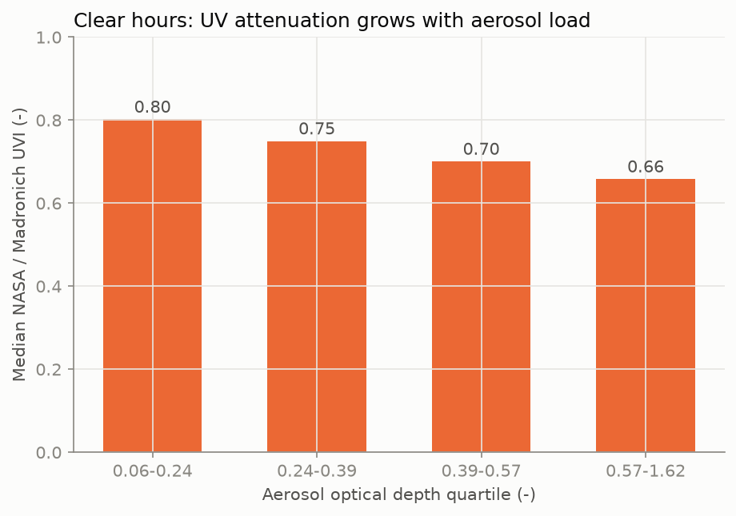
*รูปที่ 1 อัตราส่วน NASA POWER / ฟ้าใส ในชั่วโมงฟ้าเปิด เทียบกับ AOD `[docs/figures/phys_aod_ratio.png]`*

---

## 4. ข้อมูลและ ground truth

**ตาราง 2** แหล่งข้อมูล `[docs/datasets.md]`

| แหล่ง | ใช้ทำอะไร | หมายเหตุ |
|---|---|---|
| Open-Meteo Historical Forecast + Forecast API | features (ตอนฝึก / ตอนใช้งาน) | ไม่ต้องใช้ API key ค่าตรงกัน 16/16 ตัวแปร |
| Open-Meteo Air Quality (CAMS) | features | AOD, dust, PM2.5, ozone ผิวพื้น |
| NASA POWER hourly (community RE) | **target (ground truth)** | ALLSKY UV Index, UVA, UVB |
| TEMIS (กรุงเทพฯ), NASA OMI | **ทดสอบเท่านั้น** ห้ามใช้ฝึก | TEMIS มีแค่ฟ้าใส, OMI วันละครั้ง |
| CCSN, SWIMCAT-ext, SWIMSEG | CNN ภาพท้องฟ้า | ชุดข้อมูลสาธารณะ (CC0, CC BY 4.0, CC BY-NC 4.0) |

**เลือก ground truth ด้วยกฎที่ประกาศก่อนดูผล:** เลือก NASA POWER ก็ต่อเมื่อ MAE เทียบ OMI (ปี 2023) ต่ำกว่า Open-Meteo **เกิน 0.3**

**ตาราง 3** `[docs/source_selection_2023.csv]`

| แหล่ง | เทียบกับ | n | MAE |
|---|---|---|---|
| Open-Meteo `uv_index` | OMI (ฟ้ามีเมฆ) | 275 | 2.428 |
| NASA POWER | OMI (ฟ้ามีเมฆ) | 275 | **1.143** |

→ เลือก **NASA POWER** (ต่างกัน 1.285 > 0.3)

**ตารางข้อมูลฝึก:** 11,156 ชั่วโมงกลางวัน (2023: 3,712 / 2024: 3,726 / 2025: 3,718) features 23 ตัวมาจาก Open-Meteo หรือคำนวณจากเวลา/ตำแหน่งเท่านั้น เช่น มุมดวงอาทิตย์, เมฆ 3 ระดับ, รังสี shortwave, AOD, PM2.5 **ห้ามใช้คอลัมน์ NASA POWER เป็น feature** เพราะไม่มีตอนใช้งานจริงและเป็น target leakage `[source_code/models/dataset_spec_v1.json]`

---

## 5. วิธีการ

### 5.1 แบ่งข้อมูลตามเวลาและกันข้อมูลรั่ว
- **Train = 2023, Dev = 2024, Test = 2025** ข้อมูลปี 2025 ถูกกรองออกตั้งแต่ตอนอ่าน และโค้ดตรวจว่าไม่มีแถวปี 2025 หลุดเข้ามา
- **Cross-validation:** TimeSeriesSplit 5 folds ภายใน 2023–2024 เว้น gap ≈ 1 วัน ไม่สุ่มแบ่ง
- **Pre-registration:** เกณฑ์ของ test ทุกชุด commit ไว้ก่อนเปิด test และโค้ดมี guard ให้รัน `--test` ได้ครั้งเดียว หลังเห็นผลไม่แก้โมเดล
- **ตรวจข้อมูลรั่ว 5 ข้อผ่านทั้งหมด** เช่น feature ที่สัมพันธ์กับ target สูงสุด |Spearman| 0.656 และโมเดลที่ฝึกกับ target สุ่มสลับได้ R² −0.105 `[docs/leakage_checks.csv]`

### 5.2 โมเดล
1. **Baseline:** CMF คงที่, `uv_index` ของ Open-Meteo, linear regression
2. **XGBoost multi-output:** ทำนาย CMF_UVI, CMF_A, CMF_B พร้อมกัน
3. **Optuna** 100 trials พร้อมกฎรับ params ที่ประกาศไว้ (MAE ดีขึ้น > 0.01 และ recall ลดไม่เกิน 0.03)
4. **Quantile XGBoost + CQR** ให้ช่วง q10–q90 ที่ปรับให้ coverage ใกล้ 80 % ในระบบใช้ `alert_uvi = max(q90, ค่าประมาณ)`
5. **LSTM encoder–decoder** (48 ชม. ย้อนหลัง → 24 ชม. ข้างหน้า) เทียบกับ XGBoost สำหรับพยากรณ์
6. **CNN ภาพท้องฟ้า:** MobileNetV3Small (transfer learning) + head แยกตาม dataset, export TFLite

---

## 6. ผลลัพธ์

### 6.1 Dev 2024 (เลือกโมเดล)

**ตาราง 4** `[docs/baseline_dev_2024.csv]`

| โมเดล | UVI MAE | R² | recall สูงมาก |
|---|---|---|---|
| CMF คงที่ | 0.703 | 0.889 | 0.631 |
| Open-Meteo `uv_index` | 1.252 | 0.676 | 0.591 |
| Linear regression | 0.473 | 0.941 | 0.767 |
| **XGBoost** | **0.462** | **0.943** | **0.791** |

- TimeSeriesSplit 5 folds: UVI 0.493 ± 0.078 `[docs/cv_folds_2023_2024.csv]`
- Optuna: CV MAE 0.4579 → 0.4466 ผ่านกฎแบบเฉียดฉิว `[docs/tuning_dev_2024.csv]`
- ช่วง q10–q90 ดิบมี coverage แค่ 0.593 (ต่ำกว่าเป้า) จึงใช้ CQR ได้ 0.837 บน dev `[source_code/models/cmf_uvi_quantile_xgb_v1_metrics.json]`
- ใช้ q90 เตือนแล้ว recall ≥ สูงมาก 0.989 (q50 ได้ 0.839) แลกกับ precision ที่ลดลง `[docs/quantile_alerts_cv_folds3-5.csv]`

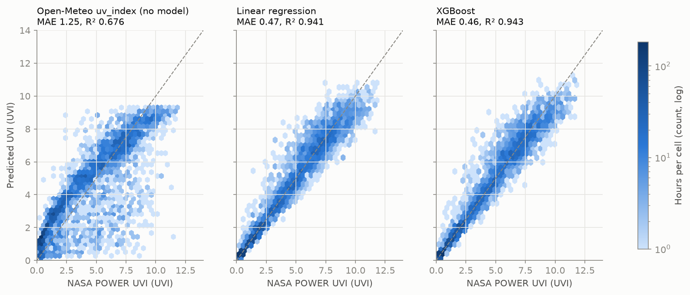
*รูปที่ 2 UVI ที่ทำนายเทียบ NASA POWER บน dev 2024 `[docs/figures/base_pred_vs_nasa_dev2024.png]`*

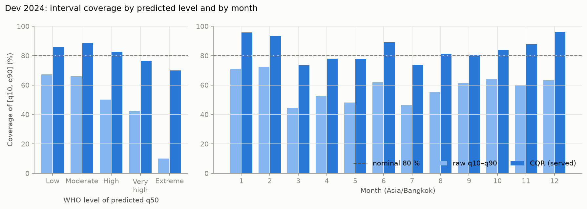
*รูปที่ 3 coverage ของช่วง q10–q90 ก่อนและหลัง CQR `[docs/figures/quantile_coverage.png]`*

### 6.2 Test 2025 (ประเมินครั้งเดียว)
โมเดลฝึกใหม่บน 2023–2024 แล้วประเมินกับปี 2025 ครั้งเดียว **ผ่าน 14 จาก 15 เกณฑ์**

**ตาราง 5** เกณฑ์ test 2025 (คัดมา) `[docs/test_2025_criteria.csv]`

| # | เกณฑ์ | ค่า | ผ่าน |
|---|---|---|---|
| T1 | MAE รายชั่วโมงเทียบ NASA POWER < 1.0 | 0.479 | ✅ |
| T1b | ต่ำกว่า baseline ทุกตัว (ต่ำสุด CMF คงที่ 0.708) | 0.479 | ✅ |
| T2a | MAE ตอนเที่ยงเทียบ OMI ≤ 1.5 | 1.320 | ✅ |
| T3b | โมเดลเทียบ TEMIS วันฟ้าเปิด ≤ 1.5 | 1.360 | ✅ |
| **T4** | **Pearson r กับ OMI irradiance ≥ 0.7 ทั้ง 4 ความยาวคลื่น** | **ต่ำสุด 0.533** | **❌** |
| T5 | coverage ช่วง CQR อยู่ใน [0.75, 0.85] | 0.806 | ✅ |
| T6a | q90 เตือน ≥ สูงมาก recall ≥ 0.90 | 0.986 | ✅ |
| T6b | precision ≥ 0.50 | 0.564 | ✅ |
| T6c | false alarm rate ≤ 0.20 | 0.163 | ✅ |
| T6d | q90 เตือนรุนแรงมาก recall ≥ 0.80 | 0.826 (19/23) | ✅ |

ผลอื่น: n = 3,718 ชม., R² 0.934, UVA MAE 2.910 W/m², UVB 0.088 W/m² `[docs/test_2025_results.json]` **T4 ไม่ผ่าน** แต่ r ของโมเดลสูงกว่า physics ฟ้าใสทุกความยาวคลื่น (T4b ผ่าน)

**ตาราง 6** confusion matrix ระดับ WHO ของ q90 (แถว = จริง, คอลัมน์ = ที่แอปบอก) `[docs/test_2025_results.json]`

| จริง \ q90 | ต่ำ | ปานกลาง | สูง | สูงมาก | รุนแรงมาก | recall |
|---|---|---|---|---|---|---|
| ต่ำ | 1087 | 201 | 5 | 3 | 0 | 0.839 |
| ปานกลาง | 0 | 651 | 297 | 67 | 0 | 0.641 |
| สูง | 0 | 5 | 319 | 425 | 4 | 0.424 |
| **สูงมาก** | 0 | 0 | 9 | 535 | 87 | **0.848** |
| **รุนแรงมาก** | 0 | 0 | 0 | 4 | 19 | **0.826** |

ค่าส่วนใหญ่อยู่บนเส้นทแยงหรือ**สูงกว่าจริงหนึ่งระดับ** ซึ่งเป็นผลที่ตั้งใจของการใช้ค่าบน: เตือนเกินดีกว่าเตือนช้า

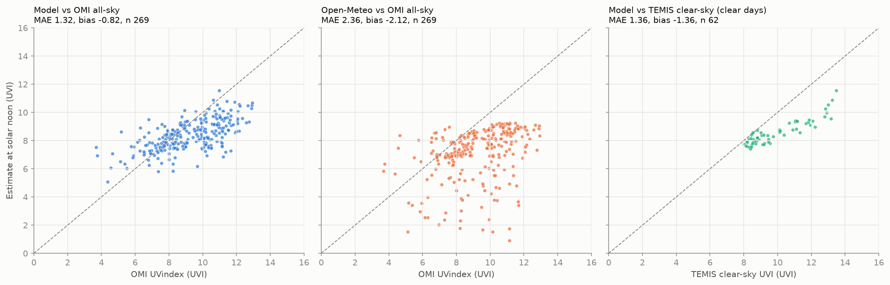
*รูปที่ 4 UVI ตอนเที่ยงปี 2025 เทียบ OMI และ TEMIS (test) `[docs/figures/test2025_noon_scatter.png]`*

### 6.3 พยากรณ์ 6–24 ชม.: LSTM ไม่ชนะ จึงใช้ XGBoost

**ตาราง 7** `[source_code/models/lstm_v1_metrics.json]`, `[docs/lstm_test_2025.json]`

| | LSTM | XGBoost | เกณฑ์ LSTM ชนะ | ผ่าน |
|---|---|---|---|---|
| dev 2024 MAE | 0.463 ± 0.007 | 0.450 | < 0.450 − 0.02 | ❌ |
| test 2025 MAE | 0.497 ± 0.004 | 0.480 | < 0.480 − 0.02 | ❌ |

LSTM แย่กว่าทุกระยะพยากรณ์ (bias +0.168) แอปจึงใช้ XGBoost ทั้งค่าปัจจุบันและพยากรณ์

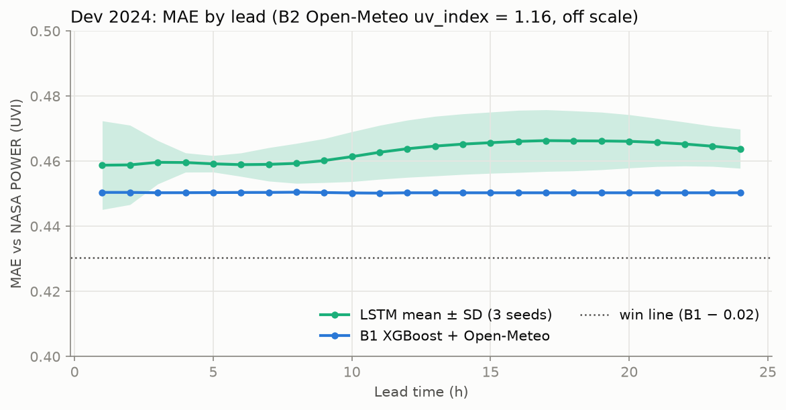
*รูปที่ 5 MAE ของ LSTM เทียบ baseline ตามระยะพยากรณ์ (dev 2024) `[docs/figures/lstm_dev_by_lead.png]`*

### 6.4 โมดูลภาพท้องฟ้า (แยกจากโมเดล UV)
ไม่มีภาพท้องฟ้าปทุมธานีที่จับคู่กับ target ได้ จึงทำเป็นโมดูลแยก **แสดงผลประกอบ ไม่เปลี่ยน UVI**

**ตาราง 8** `[docs/sky_cnn_test.json]`, `[docs/sky_cloud_test.json]`

| งาน | ผล | เกณฑ์ | ผ่าน |
|---|---|---|---|
| CCSN ชนิดเมฆ 11 คลาส | accuracy 0.486 | ≥ 0.60 | ❌ (ไม่แสดงในแอป) |
| SWIMCAT-ext สภาพท้องฟ้า 6 คลาส | accuracy 0.975 | ≥ 0.85 | ✅ |
| สัดส่วนเมฆ SWIMSEG (CNN) | MAE 0.084 | ≤ 0.10 | ✅ |
| CNN ดีกว่า red/blue ratio (0.145) | +0.061 | ≥ 0.03 | ✅ |

ในแอปแสดงสัดส่วนเมฆเป็นระดับ น้อย/ปานกลาง/มาก พร้อมข้อความ "สัดส่วนเมฆในภาพ ไม่ใช่ทั้งท้องฟ้า" ส่วนชนิดเมฆของ CCSN ไม่แสดงเพราะไม่ผ่านเกณฑ์

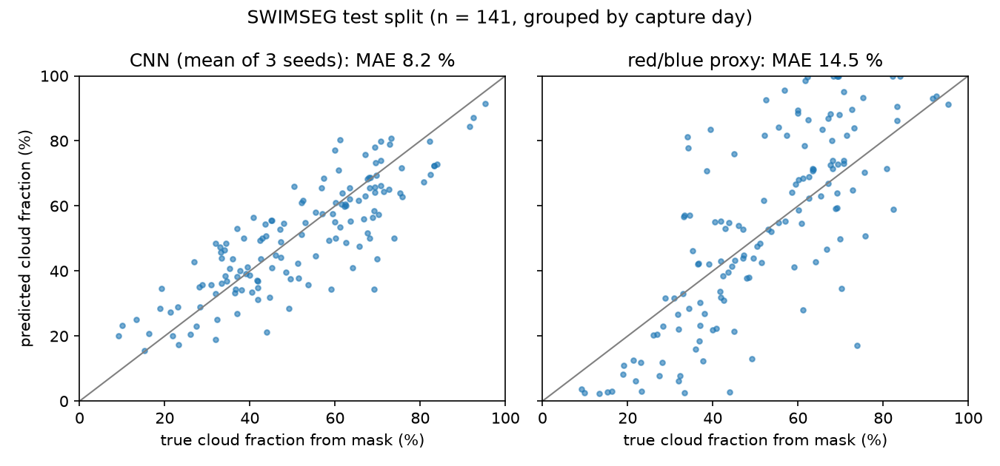
*รูปที่ 6 สัดส่วนเมฆที่ CNN และ red/blue ทำนายเทียบกับ mask ของ SWIMSEG (test) `[docs/figures/sky_cloud_test_scatter.png]`*

### 6.5 การทดลองเสริม: เมฆจากดาวเทียม Himawari-9
เพิ่ม features ดาวเทียม 3 ตัว: บน dev 2024 MAE ดีขึ้นจาก 0.451 เป็น 0.411 แต่บน test ม.ค.–มิ.ย. 2026 ดีขึ้นแค่ 0.007 (เป้า > 0.02, CI [−0.007, 0.020] คร่อม 0) → **ไม่ผ่าน ไม่ใส่ในแอป** ผลพลอยได้คือโมเดลหลักได้ MAE 0.470 บนข้อมูลใหม่ปี 2026 ใกล้กับ 0.479 ของปี 2025 แสดงว่าไม่ได้ดีเฉพาะปีที่ทดสอบ `[docs/sat_test_2026_results.json]`

---

## 7. ระบบซอฟต์แวร์

- **FastAPI:** โหลดโมเดลครั้งเดียวตอนเริ่ม ใช้ input จาก Open-Meteo เท่านั้น ตรวจแล้วว่า features ตอนใช้งานตรงกับตอนฝึกทั้ง 23 ตัว (ต่างกันสูงสุด 0) endpoint หลัก `/health`, `/predict`, `/forecast`, `/sky-image`, `/users` `[docs/api.md]`
- **PostgreSQL:** ไม่เก็บชื่อ อีเมล หรือภาพ พิกัดปัดเหลือ 0.01° ลบผู้ใช้แล้วข้อมูลถูกลบตาม `[docs/db.md]`
- **PDPA:** ประเภทผิวเป็นข้อมูลสุขภาพ จึงส่งไปเซิร์ฟเวอร์เมื่อผู้ใช้ยินยอมเองเท่านั้น ภาพท้องฟ้าลบ EXIF และไม่เก็บ (`stored: false`)
- **แอป Expo (TypeScript):** แบบสอบถามผิว 5 ข้อ, หน้าหลัก (UVI + ช่วง, UVA/UVB, เวลาผิวไหม้, กราฟรายชั่วโมง), ปุ่ม "ออกแดด" สะสมปริมาณ UV แล้วเตือนที่ 80 % ของ MED, กล้องถ่ายท้องฟ้า, วัดแสง (Android), เลือก 77 จังหวัดเมื่อไม่ให้สิทธิ์ตำแหน่ง
- **การแจ้งเตือน:** UV สูง (ตามค่าบน), UV ลดลงแล้ว (hysteresis), cooldown 3 ชม., สรุป 07:00, ใกล้ผิวไหม้, ทาครีมซ้ำทุก 2 ชม., ไม่เตือนตอนกลางคืน
- **เทสอัตโนมัติ:** pytest 402 passed, Jest 340 passed (30 suites) `[README.md]`

<table>
<tr><td>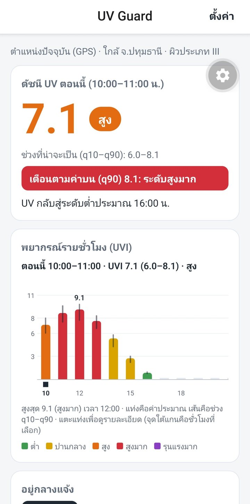<br>(ก) หน้าหลัก UVI 7.1 (6.0–8.1)</td><td>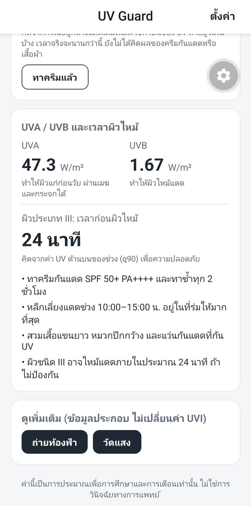<br>(ข) UVA/UVB และเวลาผิวไหม้ 24 นาที</td><td>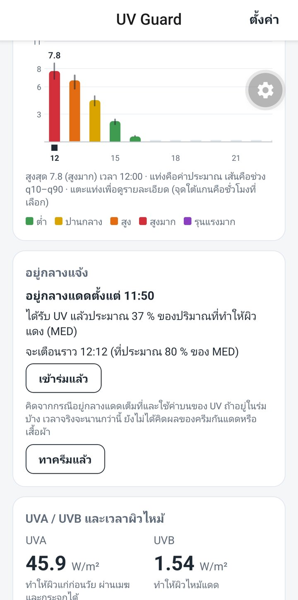<br>(ค) การ์ด "ออกแดด" หลังแก้บั๊ก</td><td>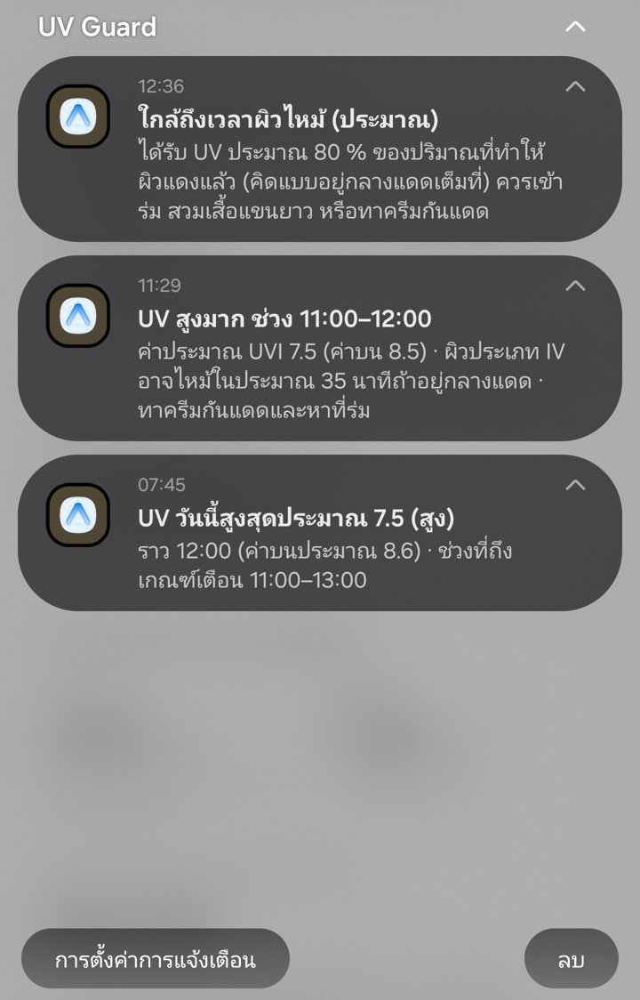<br>(ง) แจ้งเตือนใกล้ผิวไหม้</td></tr>
</table>

<table>
<tr><td>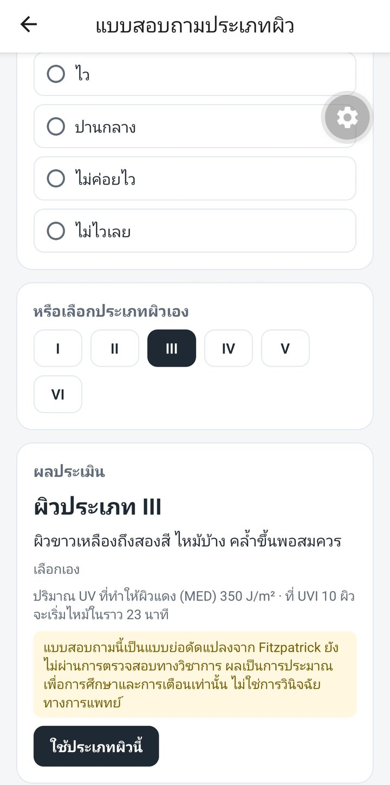<br>(จ) แบบสอบถามประเภทผิว 5 ข้อ</td><td>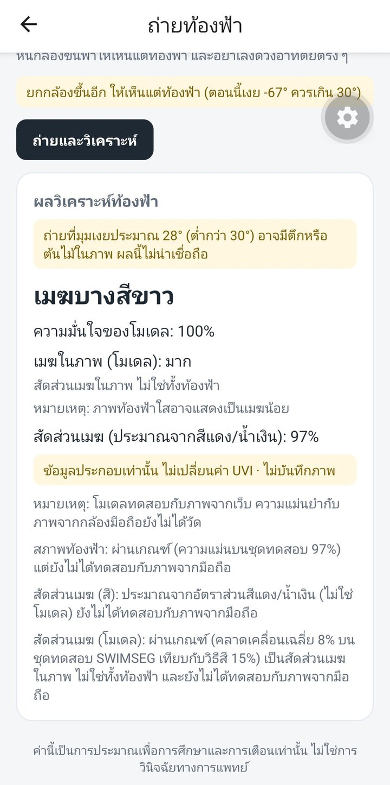<br>(ฉ) ผลวิเคราะห์ภาพท้องฟ้า + ป้ายมุมต่ำ</td><td>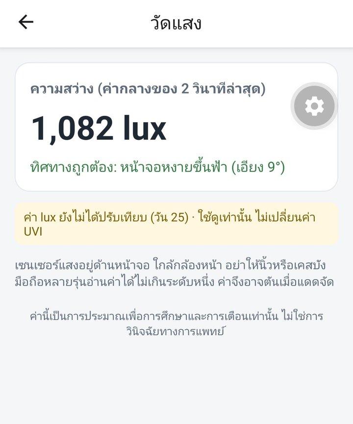<br>(ช) วัดแสง (Android)</td><td>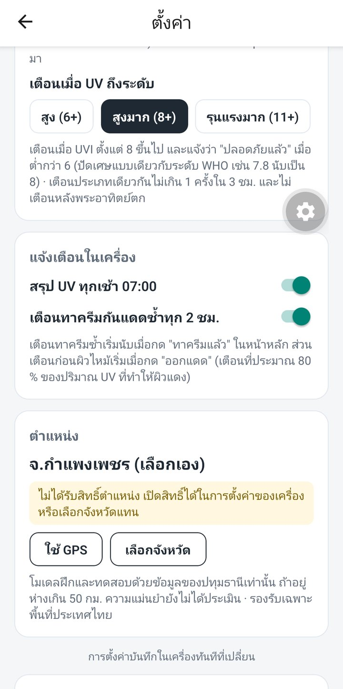<br>(ซ) ตั้งค่าเมื่อไม่มีสิทธิ์ตำแหน่ง</td></tr>
</table>

*รูปที่ 7 ภาพหน้าจอจาก Samsung Galaxy S23 Ultra (4 ต.ค. และ 21–25 ต.ค. 2026) `[docs/screenshots/]`*

---

## 8. ทดสอบบนมือถือจริง

ทดสอบ 2 รอบด้วย development build บน Samsung Galaxy S23 Ultra (Android 16) ที่ปทุมธานี ผู้ทดสอบคนเดียว ผลมาจาก**บันทึกของผู้ทดสอบ** `[docs/field_test_2026-10-04.md]`, `[docs/field_test_2026-10-21.md]`, `[dataset/field/]`

**ตาราง 9** สรุปผลทดสอบภาคสนาม

| รอบ | ผ่าน | บั๊กที่พบและแก้แล้ว |
|---|---|---|
| 1 (4 ต.ค.) | หน้าหลัก, กล้อง (ตัด EXIF), วัดแสง, แจ้งเตือน UV สูง/ทาครีมซ้ำ/UV ลดลง | % ของ MED ค้างหลังล็อกจอ, แจ้งเตือนที่เลยเวลาถูกยกเลิก, ไม่รีเฟรชเมื่อข้ามชั่วโมง, เตือนผิวไหม้ข้ามวัน |
| 2 (21–25 ต.ค.) | สรุปตอนเช้า, ออกแดดข้ามชั่วโมง, ทาครีมซ้ำ, สิทธิ์ตำแหน่ง 4 กรณี, ปิดแจ้งเตือน, ลบข้อมูล, หลุดเครือข่าย | การเตือนผิวไหม้หายเมื่อข้ามชั่วโมง (`bb3100b`), ปุ่ม "ใช้ GPS" ไม่แสดง (`eda6a4d`) |

**ตรวจสูตรในแอป:** กดออกแดด 10:08 ที่ค่าบน 8.1 ผิว III แอปบอกจะเตือน 10:31 ตรงกับ 280 J/m² ÷ (8.1 × 0.025) ≈ 23 นาที; รอบ 2 หลังแก้บั๊ก การ์ดแสดง 37 % ของ MED และ "จะเตือนราว 12:12" (สูตรได้ 36.4 % และ 12:12) และแจ้งเตือนมาจริง

**เวลาแจ้งเตือน:** ตรงเวลาถึงช้า 9 นาทีเมื่อจอเปิดอยู่ แต่ช้า 24–57 นาทีเมื่อล็อกจอทิ้งไว้หรือเปิดโหมดประหยัดแบต เพราะแอปตั้งเวลาแบบไม่ตรงเวลา (ไม่ได้ขอสิทธิ์ `SCHEDULE_EXACT_ALARM`) `[dataset/field/field_notifications_2026-10.csv]`

**เทียบ Open-Meteo:** 25 ต.ค. 12:00 แอป 7.8 เทียบ Open-Meteo 7.75 (เมฆ 62 %) เป็นการเทียบค่าประมาณกับค่าประมาณ **ไม่ใช่การวัดความแม่นยำ** `[dataset/field/field_uvi_2026-10.csv]`

**บทเรียน:** บั๊กที่เจอบนมือถือผ่านเทสอัตโนมัติมาแล้ว เพราะเทส mock ส่วนที่พังจริง (fetch, native module, เวลาข้ามชั่วโมง) การทดสอบบนเครื่องจริงจึงจำเป็น และบั๊กทุกตัวมีเทสกันไว้หลังแก้

---

## 9. การตัดสินใจสำคัญและหลักฐาน

ทุกการตัดสินใจด้านล่างใช้กฎหรือเกณฑ์ที่เขียนไว้ก่อนดูผล `[ROADMAP.md]`, `[docs/report.md]`

**ตาราง 10**

| การตัดสินใจ | หลักฐาน | ผล |
|---|---|---|
| ใช้ NASA POWER เป็น ground truth | MAE เทียบ OMI 1.143 เทียบ Open-Meteo 2.428 (กฎ: ต่างกัน > 0.3) | ใช้ NASA POWER |
| ทำนาย CMF แทน UVI ตรง ๆ | ฟิสิกส์อธิบายมุมดวงอาทิตย์และโอโซน ML เรียนเฉพาะเมฆ + ฝุ่น | XGBoost ทำนาย CMF |
| แบ่งข้อมูลตามปี ไม่สุ่ม | ข้อมูลเป็นอนุกรมเวลา สุ่มแบ่งทำให้ผลดีเกินจริง | Train 2023 / Dev 2024 / Test 2025 |
| ใช้ CQR | coverage ช่วงดิบ 0.593 ต่ำกว่าเป้า 0.75–0.85 | test 2025 ได้ 0.806 |
| เตือนด้วย q90 | q50 recall ≥ สูงมาก 0.839, q90 0.989 (CV) | เตือนเกินดีกว่าเตือนช้า |
| ใช้ XGBoost พยากรณ์แทน LSTM | LSTM ไม่ต่ำกว่า XGBoost เกิน 0.02 ทั้ง dev และ test | ใช้ XGBoost |
| CNN ภาพท้องฟ้าเป็นโมดูลแยก | ไม่มีภาพปทุมธานีที่จับคู่กับ target ได้ | ไม่เปลี่ยน UVI |
| ไม่แสดงชนิดเมฆ CCSN | accuracy 0.486 < 0.60 | แสดงเฉพาะ SWIMCAT-ext + สัดส่วนเมฆ |
| ไม่ใส่ดาวเทียม Himawari | test 2026 ดีขึ้น 0.007 < 0.02, CI คร่อม 0 | แอปใช้โมเดลเดิม |

**สิ่งที่ทำเพื่อให้ผลเชื่อถือได้:** แยก test ออกตั้งแต่ตอนอ่านข้อมูล, ตรวจข้อมูลรั่ว 5 ข้อ, ห้ามใช้ข้อมูลที่ไม่มีตอนใช้งานจริงเป็น feature, ใช้แหล่งตรวจสอบอิสระ (OMI, TEMIS) ที่ไม่เคยใช้ฝึก, เปิด test ครั้งเดียวแล้วไม่แก้โมเดล และรายงานผลที่ไม่ผ่านทุกข้อ

---

## 10. ข้อจำกัด

1. **ไม่มีเครื่องวัด UV ภาคพื้นดิน:** ground truth เป็น NASA POWER (ดาวเทียม/แบบจำลอง กริดหยาบ) โมเดลรับ bias ต่ำของ NASA มาด้วย วันฟ้าเปิดต่ำกว่า TEMIS 1.36 UVI **ค่าสูงสุดตอนเที่ยงอาจต่ำกว่าจริง**
2. **พื้นที่เดียว:** ฝึกและทดสอบที่ปทุมธานีเท่านั้น นอกพื้นที่ API แนบข้อความว่ายังไม่ได้ประเมิน
3. **การเตือนระดับรุนแรงมาก:** มีแค่ 23 ชม. ในปี 2025 recall จึงไม่แน่นอน (95 % CI 0.63–0.93) และ precision 0.17
4. **UVA/UVB:** ไม่ผ่าน T4 และ UVB จาก SPECTRL2 ครอบคลุมแค่ 300–315 nm
5. **ภาพท้องฟ้า:** ยังไม่ได้วัดผลกับภาพจากมือถือ ภาพจากมือถือ 4 ภาพในรอบแรกได้ "เมฆบางสีขาว 100 %" ทั้งหมด (domain gap)
6. **การแจ้งเตือน:** ช้าเมื่อเครื่องพัก, push จากเซิร์ฟเวอร์ทดสอบด้วยตัวส่งปลอมเท่านั้น, ไม่ได้ทดสอบ iOS
7. **ปุ่ม "ออกแดด":** นับแบบกลางแดดเต็มที่และไม่จบเอง (ลืมปิดแล้วขึ้นถึง 606 % ของ MED)
8. **ค่า MED และแบบสอบถามผิว:** ยังไม่มีแหล่งอ้างอิงและยังไม่ผ่านการตรวจสอบทางวิชาการ เวลาผิวไหม้เป็นค่าประมาณ
9. **ทดสอบภาคสนามจำกัด:** ผู้ทดสอบคนเดียว มือถือเครื่องเดียว 5 วันที่มีแดด

`[docs/report.md §5]`

---

## 11. งานต่อยอดและสรุป

**งานต่อยอด** `[docs/report.md §6]`
1. ขอข้อมูลเครื่องวัด UV ภาคพื้นดิน (เช่น ม.ศิลปากร นครปฐม) มาเป็น ground truth เพิ่ม
2. ฝึกและทดสอบหลายพื้นที่ก่อนเปิดใช้นอกปทุมธานี
3. แจ้งเตือนตรงเวลาด้วย `SCHEDULE_EXACT_ALARM` และจบ session "ออกแดด" อัตโนมัติ
4. ทดสอบ push จริงผ่าน FCM และ iOS
5. เก็บภาพท้องฟ้าจากมือถือพร้อม label เพื่อวัดผล CNN และปฏิเสธภาพนอกการกระจาย
6. ทดลองดาวเทียม Himawari ซ้ำกับช่วงเมฆมาก (ก.ค.–ธ.ค. 2026) ด้วยเกณฑ์ใหม่ที่ประกาศก่อน

**สรุป**

UV Guard แสดงว่าสมาร์ตโฟนกับข้อมูลฟรีสามารถประเมิน UV และเตือนความเสี่ยงผิวไหม้รายบุคคลได้ โดยไม่ต้องใช้อุปกรณ์เสริม แนวทางฟิสิกส์ × ML ลด MAE จาก 1.244 (Open-Meteo `uv_index`) เหลือ 0.479 UVI บน test ปี 2025 และการเตือนด้วยค่าบนจับชั่วโมงที่ UV สูงมากได้ 98.6 % จุดเด่นของงานคือ**ความโปร่งใสของการประเมิน**: เกณฑ์ทุกข้อประกาศก่อนดูผล test เปิดครั้งเดียว และผลที่ไม่ผ่าน (T4, LSTM, CCSN, Himawari) ถูกรายงานและใช้ตัดสินใจจริง ข้อจำกัดหลักคือยังไม่มีเครื่องวัด UV ภาคพื้นดินและทดสอบที่ปทุมธานีที่เดียว

---
*ผลทั้งหมดเป็นค่าประมาณเพื่อการศึกษาและการเตือน ไม่ใช่การวินิจฉัยทางการแพทย์*
