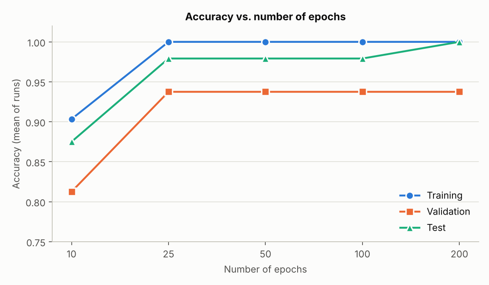
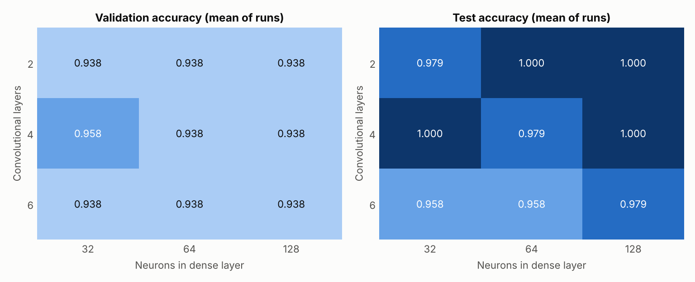
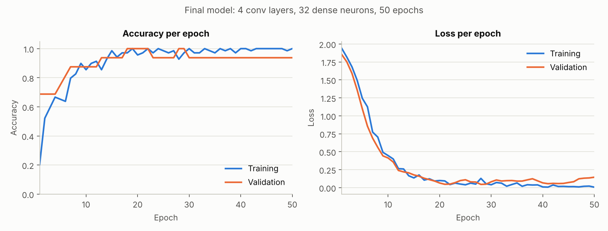
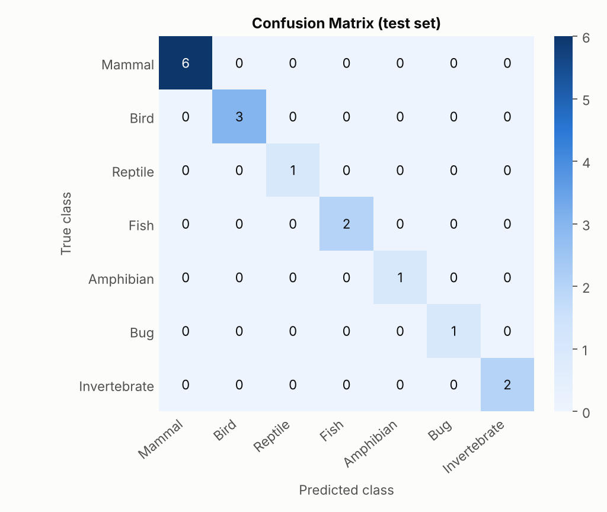
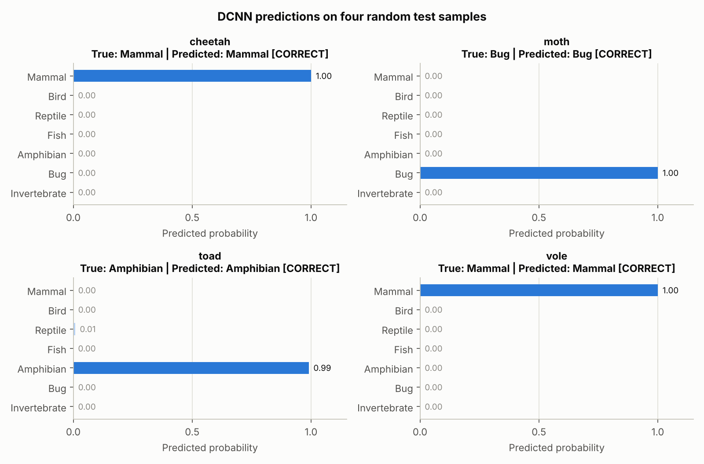

# ML-08 — Deep Convolutional Neural Network (DCNN)

Classifying animals into 7 classes with a **VGG-style Deep CNN** on the UCI **Zoo** dataset, and comparing
how the **number of epochs** and the **DCNN configuration** (number of convolutional layers and dense
neurons) affect accuracy.

> The lab template is written for images (a `PetImages/` folder and a 2D VGG). The dataset chosen here is
> tabular, so the same pipeline is implemented as a **1D VGG** (`Conv1D` / `MaxPooling1D`): the 16 features
> of each animal are treated as a sequence of length 16 with 1 channel. File names follow the template;
> `PetImages/` is not needed.

| | |
|---|---|
| Dataset | Zoo — 101 animals, 16 features, 7 classes |
| Model | VGG-style 1D DCNN (TensorFlow / Keras) |
| Final model | 4 conv layers, 32 dense neurons, 50 epochs (30,247 parameters) |
| Final accuracy | train 100.00% · validation 93.75% · **test 100.00%** (16 test samples) |

Full write-up (in Thai): [`report.pdf`](report.pdf)

## Lab objectives

- Select and load a dataset, split it into training and testing sets, and standardize the input features.
- Build a DCNN model and train it with different numbers of epochs.
- Compare different DCNN configurations (number of convolutional layers and neurons).
- Evaluate every model using accuracy; report training/validation accuracy and loss, and predictions.

## Project structure

```
ML-08-DCNN/
│
├── dataset.csv                     # Zoo dataset (101 rows: animal_name, 16 features, class_type, class_name)
├── report.pdf                      # Lab report (Thai)
├── README.md
├── requirements.txt
│
└── classification/
    ├── main.py                     # Main training pipeline (runs both experiments + final model)
    ├── data_loader.py              # Load dataset.csv and skip corrupted rows
    ├── preprocessing.py            # Standardize features and reshape to (16, 1) for Conv1D
    ├── split_data.py               # Stratified split into training, validation, and test sets
    ├── vgg_model.py                # Build, train, save, and predict using the VGG-style model
    ├── evaluate.py                 # Accuracy, classification report, confusion matrix, and plots
    ├── test_vgg.py                 # Test the trained model using four random test samples
    │
    └── outputs/                    # Generated files
        ├── labels.npy              # Labels of the whole dataset (0-6)
        ├── classes.json            # Class names, index = label
        ├── X_train.npy / X_val.npy / X_test.npy      # Standardized inputs
        ├── y_train.npy / y_val.npy / y_test.npy      # Labels
        ├── scaler.json             # Mean / std used for standardization
        ├── split_index.json        # Row indices of each split
        ├── vgg_model.keras         # Trained final model
        ├── history.json            # Training / validation accuracy and loss per epoch
        ├── results.json            # Every number from both experiments
        ├── classification_report.txt
        ├── predictions.csv         # Predictions on the test set
        ├── epoch_comparison.png
        ├── config_comparison.png
        ├── training_history.png
        ├── confusion_matrix.png
        └── prediction_sample.png
```

## Dataset

`dataset.csv` is the [UCI Zoo dataset](https://archive.ics.uci.edu/dataset/111/zoo) (`zoo.csv` merged with
the class names from `class.csv`).

- **15 boolean features:** hair, feathers, eggs, milk, airborne, aquatic, predator, toothed, backbone,
  breathes, venomous, fins, tail, domestic, catsize
- **1 numeric feature:** legs (0, 2, 4, 5, 6, 8)
- **Label:** `class_type` 1–7

| Label | Class | Samples | Train | Val | Test |
|:-:|---|--:|--:|--:|--:|
| 0 | Mammal | 41 | 28 | 7 | 6 |
| 1 | Bird | 20 | 14 | 3 | 3 |
| 2 | Reptile | 5 | 3 | 1 | 1 |
| 3 | Fish | 13 | 9 | 2 | 2 |
| 4 | Amphibian | 4 | 2 | 1 | 1 |
| 5 | Bug | 8 | 6 | 1 | 1 |
| 6 | Invertebrate | 10 | 7 | 1 | 2 |
| | **Total** | **101** | **69** | **16** | **16** |

The dataset is small and imbalanced, so the split is **stratified** and every setting is trained
**3 times with different seeds** and averaged.

## How to run

```bash
pip install -r requirements.txt

cd classification
python main.py              # both experiments + final model (about 5-6 minutes on CPU)
python test_vgg.py          # predict four random test samples
python test_vgg.py --seed 7 # reproduces outputs/prediction_sample.png
```

Seeds are fixed and TensorFlow op determinism is enabled, so re-running on the same machine reproduces
the numbers below. Small differences are possible on other hardware or TensorFlow versions.

## Method

1. **Load** — read `dataset.csv`, skip rows with missing / non-numeric values or an invalid class.
2. **Split** — stratified 69 / 16 / 16 (about 70 / 15 / 15) into train / validation / test.
3. **Standardize** — `z = (x − mean) / std`, with mean and std computed on the **training set only**.
4. **Model** — VGG-style blocks of `[Conv1D → Conv1D → MaxPooling1D]`, filters 32 → 64 → 128,
   then `Flatten → Dense → Dropout(0.3) → Dense(7, softmax)`. Adam (lr 0.001), batch size 16.
5. **Experiment 1** — same model (4 conv, 64 neurons), epochs = 10, 25, 50, 100, 200.
6. **Experiment 2** — conv layers {2, 4, 6} × dense neurons {32, 64, 128} at the best epoch count.
7. **Selection** — highest mean validation accuracy (ties → lowest validation loss). The test set is
   never used for choosing.

## Results

### Experiment 1 — number of epochs (4 conv layers, 64 neurons, mean of 3 runs)

| Epochs | Train acc | Val acc | Val loss | Test acc (mean ± std) |
|--:|--:|--:|--:|--:|
| 10 | 0.903 | 0.812 | 0.524 | 0.875 ± 0.000 |
| 25 | 1.000 | 0.938 | 0.259 | 0.979 ± 0.029 |
| **50** | **1.000** | **0.938** | **0.184** | **0.979 ± 0.029** |
| 100 | 1.000 | 0.938 | 0.293 | 0.979 ± 0.029 |
| 200 | 1.000 | 0.938 | 0.370 | 1.000 ± 0.000 |



- 10 epochs is not enough (underfitting). From 25 epochs on, accuracy is saturated.
- Validation loss is lowest at 50 epochs and rises at 100 and 200 epochs — an early sign of overfitting,
  even though accuracy does not drop. **50 epochs** is used for Experiment 2.

### Experiment 2 — DCNN configurations (50 epochs, mean of 3 runs)

| Conv layers | Dense neurons | Parameters | Train acc | Val acc | Val loss | Test acc (mean ± std) |
|:-:|:-:|--:|--:|--:|--:|--:|
| 2 | 32 | 11,687 | 1.000 | 0.938 | 0.259 | 0.979 ± 0.029 |
| 2 | 64 | 20,135 | 1.000 | 0.938 | 0.224 | 1.000 ± 0.000 |
| 2 | 128 | 37,031 | 1.000 | 0.938 | 0.280 | 1.000 ± 0.000 |
| **4** | **32** | **30,247** | **1.000** | **0.958** | **0.268** | **1.000 ± 0.000** |
| 4 | 64 | 38,695 | 1.000 | 0.938 | 0.184 | 0.979 ± 0.029 |
| 4 | 128 | 55,591 | 1.000 | 0.938 | 0.167 | 1.000 ± 0.000 |
| 6 | 32 | 104,231 | 1.000 | 0.938 | 0.385 | 0.958 ± 0.029 |
| 6 | 64 | 112,679 | 1.000 | 0.938 | 0.541 | 0.958 ± 0.029 |
| 6 | 128 | 129,575 | 1.000 | 0.938 | 0.537 | 0.979 ± 0.029 |



- All nine configurations reach 0.958–1.000 test accuracy; most differences equal one test sample in one run.
- The deepest models (6 conv layers, 100k+ parameters for 69 training samples) are the weakest and have
  the highest validation loss — more depth does not help on a dataset this small.
- The number of dense neurons shows no clear trend.
- Selected configuration: **4 conv layers, 32 dense neurons** (the only one with a higher mean validation accuracy).

### Final model

| Set | Samples | Accuracy |
|---|--:|--:|
| Training | 69 | 100.00% |
| Validation | 16 | 93.75% |
| **Test** | **16** | **100.00%** |



<p>
  
  
</p>

The only validation error is `seasnake` (Reptile predicted as Fish): it is aquatic, has no legs, and is
recorded as non-breathing and not egg-laying, so its features look like a fish.

## Limitations

- The test set has only 16 samples, so one wrong prediction changes accuracy by 6.25%. "100%" means
  16 of 16 correct, not a guarantee on new animals.
- Reptile, Amphibian and Bug have a single test sample each.
- Tabular features have no natural spatial order, so convolution has less of an advantage here than on images.
- Possible improvements: stratified k-fold cross-validation, `EarlyStopping` on validation loss,
  class weights, and a comparison with simpler baselines (Nearest Neighbor, MLP).

## Requirements

Python 3.10+ · TensorFlow · scikit-learn · NumPy · pandas · matplotlib (see `requirements.txt`).
