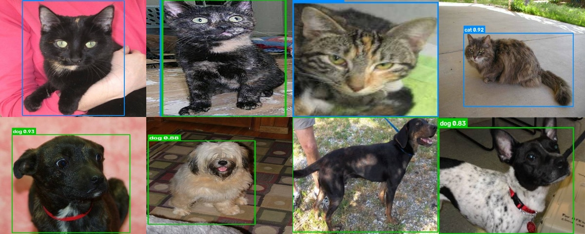
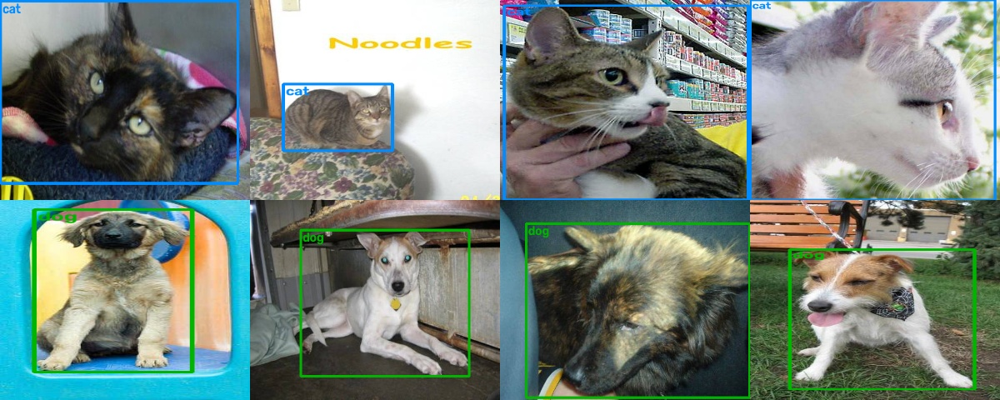
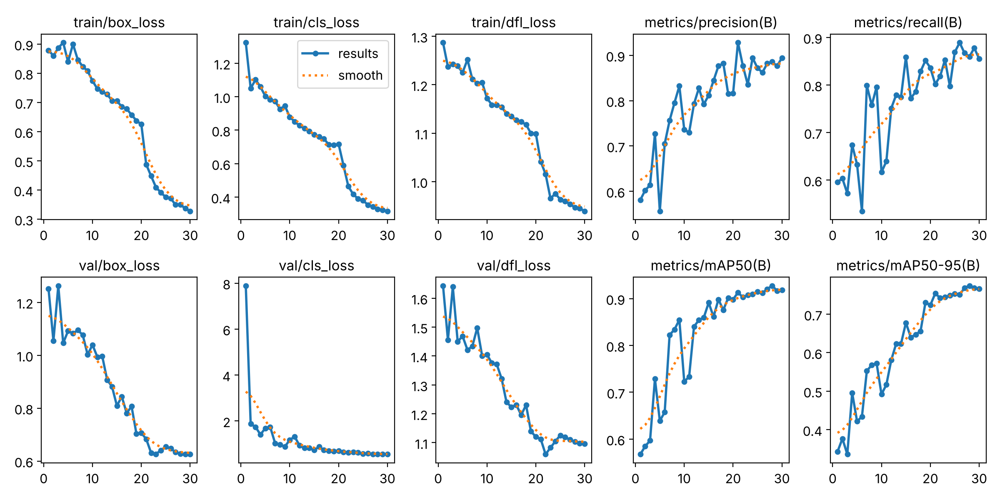

# ML-10 Object Detection II — Cat & Dog Detection with YOLOv8

ตรวจจับตำแหน่ง (bounding box) และชนิด (**cat / dog**) ของสัตว์เลี้ยงในภาพ ด้วยโมเดลตระกูล **one-stage detector (YOLOv8)**
ต่อจาก ML-09 (Object Detection I: R-CNN / Fast R-CNN ซึ่งเป็น two-stage detector)

| Metric (test set, 200 ภาพ) | ค่า |
|---|---|
| mAP@0.5 | **0.930** |
| mAP@0.5:0.95 | **0.781** |
| Precision | 0.936 |
| Recall | 0.884 |
| ความแม่นยำระดับภาพ (class ของกล่องที่มั่นใจที่สุด) | **99.0 %** (198/200) |
| เวลา inference (CPU, 416 px) | ~47 ms/ภาพ (~21 FPS) |



---

## 1. โครงสร้างโปรเจกต์

```
LAB10/  (ML-10-Object-Detection-II)
├── dataset/
│   ├── train/{images,labels}/     # 840 ภาพ (cat 420 / dog 420)
│   ├── val/{images,labels}/       # 148 ภาพ (cat 74 / dog 74)
│   ├── test/{images,labels}/      # 200 ภาพ (cat 100 / dog 100)
│   └── data.yaml
├── outputs/                       # ผลลัพธ์จากการเทรน/ทดสอบ (best.pt, กราฟ, metrics)
├── prepare_dataset.py             # แปลงรูปดิบ -> YOLO format + สร้าง label อัตโนมัติ
├── train.py                       # เทรน YOLOv8
├── evaluate.py                    # วัดผล P / R / mAP บน test set
├── image_test.py                  # ทดสอบกับรูปภาพ
├── realtime_test.py               # ทดสอบแบบ real-time (webcam / วิดีโอ)
├── dataset.csv                    # ตาราง annotation ทั้งหมด (1 แถว = 1 bounding box)
├── report.pdf                     # รายงานการทดลอง
├── requirements.txt
├── LAB10_code.ipynb
└── README.md
```

## 2. Dataset

- ที่มา: รูป Cat vs Dog (Data/training 1,000 ภาพ + Data/testing 200 ภาพ)
- ลบภาพซ้ำ 12 ภาพ (ไฟล์ `xxx(1).jpg` ที่ MD5 ตรงกับต้นฉบับ) → เหลือ 1,188 ภาพ
- แบ่ง `training` เป็น **train 85% / val 15%** แบบ stratified (seed 42) และใช้ `testing` เป็น **test**
- **Label format (YOLO):** `class x_center y_center width height` (normalize 0–1) — `0 = cat`, `1 = dog`

### การสร้าง Bounding Box
ชุดข้อมูลต้นฉบับมีเพียง **ป้ายระดับภาพ** (ชื่อไฟล์) ไม่มีกรอบ จึงใช้วิธี **auto-labeling**:
1. ใช้ YOLO11-L ที่ pre-trained บน COCO (class `cat`, `dog`) หากรอบสัตว์ (conf ≥ 0.25)
2. class ของกรอบ **ยึดตามชื่อไฟล์** เสมอ (ground truth)
3. ถ้าหาไม่เจอ ใช้กรอบเต็มภาพแทน

| label_source | จำนวนกล่อง | ความหมาย |
|---|---|---|
| `auto_yolo` | 1,333 | teacher หาเจอและ class ตรงกับชื่อไฟล์ |
| `auto_yolo_classfix` | 15 | teacher หาเจอแต่ทาย class ผิด → แก้ class ตามชื่อไฟล์ |
| `full_image_fallback` | 17 | teacher หาไม่เจอ → ใช้กรอบเต็มภาพ |

รวม 1,365 กล่อง (บางภาพมีสัตว์มากกว่า 1 ตัว) — ทุกกล่องบันทึกไว้ใน `dataset.csv`



> ⚠️ label สร้างโดยโมเดล ไม่ได้วาดด้วยมือ จึงอาจมีกรอบคลาดเคลื่อนเล็กน้อย ถ้าต้องการความแม่นยำสูงขึ้นสามารถเปิดตรวจ/แก้ใน [LabelImg](https://github.com/HumanSignal/labelImg) หรือ Roboflow ได้

## 3. ติดตั้ง

```bash
git clone https://github.com/Folktom04/ML-CPE.git
cd ML-CPE/LAB10
pip install -r requirements.txt
```

## 4. วิธีใช้งาน

```bash
# (ไม่จำเป็น) สร้าง dataset ใหม่จากรูปดิบ
python prepare_dataset.py --src path/to/Data --out dataset --teacher yolo11l.pt

# เทรน (ค่าที่ใช้ในรายงาน)
python train.py --model yolov8n.pt --epochs 30 --imgsz 416 --batch 16 --device cpu
#   มี GPU:  python train.py --device 0

# ประเมินผลบน test set
python evaluate.py --split test

# ทดสอบกับรูปภาพ (ไฟล์เดียว/โฟลเดอร์)
python image_test.py --source dataset/test/images --limit 20

# ทดสอบ real-time ด้วย webcam (กด q ออก, s บันทึกภาพ)
python realtime_test.py --source 0
python realtime_test.py --source my_video.mp4 --save
```

## 5. การตั้งค่าการเทรน

| Hyperparameter | ค่า |
|---|---|
| Model | YOLOv8n (3.0 M params, pre-trained COCO) |
| Image size | 416 × 416 |
| Epochs / Batch | 30 / 16 |
| Optimizer | AdamW, lr0 = 0.001, cosine LR |
| Augmentation | ค่าเริ่มต้นของ Ultralytics (Mosaic, HSV, flip, scale) — ปิด Mosaic 10 epoch สุดท้าย |
| Hardware | CPU 2 cores (~170 s/epoch, รวม ~85 นาที) |

## 6. ผลลัพธ์

### Validation ระหว่างเทรน

| Epoch | Precision | Recall | mAP@0.5 | mAP@0.5:0.95 |
|---|---|---|---|---|
| 1 | 0.581 | 0.596 | 0.568 | 0.343 |
| 10 | 0.736 | 0.616 | 0.723 | 0.492 |
| 20 | 0.816 | 0.836 | 0.898 | 0.724 |
| **28 (best)** | 0.886 | 0.860 | **0.928** | **0.774** |
| 30 | 0.894 | 0.855 | 0.919 | 0.766 |



### Test set (`python evaluate.py`)

| Class | Precision | Recall | mAP@0.5 | mAP@0.5:0.95 |
|---|---|---|---|---|
| all | 0.936 | 0.884 | 0.930 | 0.781 |
| cat | 0.930 | 0.923 | 0.964 | 0.799 |
| dog | 0.943 | 0.845 | 0.895 | 0.762 |

**ระดับภาพ** (เลือกกล่องที่ conf สูงสุด, conf ≥ 0.25): ทายถูก 198/200 ภาพ — cat ถูก 100/100, dog ถูก 98/100

## 7. สรุป

- YOLOv8n ซึ่งเป็น **one-stage detector** ทำนาย class + bounding box ในการ forward ครั้งเดียว จึงเร็วพอสำหรับ real-time บน CPU (~21 FPS) ต่างจาก R-CNN/Fast R-CNN ใน ML-09 ที่ต้องสร้าง region proposal ก่อน
- Transfer learning จาก COCO ทำให้ได้ mAP@0.5 = 0.93 ด้วยข้อมูลเพียง 840 ภาพ และ 30 epochs
- จุดที่ผิดพลาดส่วนใหญ่: สุนัขขนยาว/หน้าแบนที่คล้ายแมว และภาพที่สัตว์อยู่ชิดขอบหรือถูกบังบางส่วน
- แนวทางพัฒนา: ตรวจแก้ label ด้วยมือ, เพิ่ม epoch / ใช้ YOLOv8s, เทรนที่ 640 px บน GPU

## 8. References

- Ultralytics YOLOv8 — https://docs.ultralytics.com
- Redmon et al., *You Only Look Once: Unified, Real-Time Object Detection*, CVPR 2016
- Kaggle Dogs vs. Cats dataset

---
**ผู้จัดทำ:** จักรพัทศ์ ยอดระยับ (TARo) — วิศวกรรมคอมพิวเตอร์ มทร.ธัญบุรี · [github.com/Folktom04](https://github.com/Folktom04)
